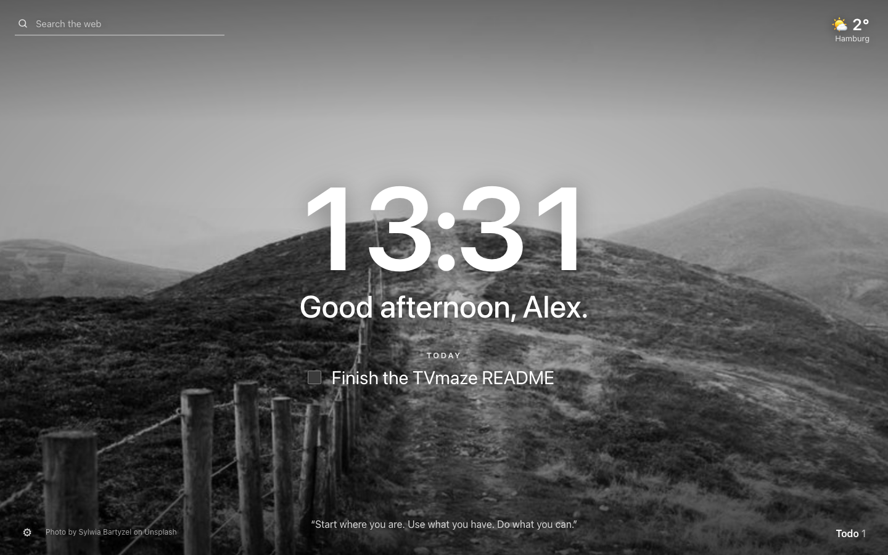

# Daybreak: my Momentum Dash replica

Daybreak is a Chrome extension that replaces the new tab page with a calm personal dashboard, my own version of the [Momentum Dash](https://momentumdash.com) browser extension. Every new tab shows:
- a new landscape photo each day
- a large clock and a greeting with your name
- your main focus for the day
- a to-do list
- the weather for your city
- a quote of the day
- a search bar



**Contents:**
[Purpose](#purpose) · [Data collection](#data-collection) · [Data persistence](#data-persistence) · [User interaction](#user-interaction) · [Setup](#setup) · [Learning](#learning) · [Limitations and assistance](#limitations-and-assistance) · [Audit](AUDIT.md)

## Purpose

This project is the *Momentum Dash replica* assignment. The goal was to rebuild the core idea of Momentum as a real browser extension: a beautiful new tab that helps you focus on what matters today. It uses plain HTML, CSS and JavaScript with **Manifest V3**, with no framework, no build step and no API key.

| Feature | What it does |
|---|---|
| Photo of the day | A different landscape photo every day, with the photographer's name and a link |
| Clock and greeting | Large clock (24 h or 12 h) and "Good morning/afternoon/evening/night, *name*." |
| Main focus | Asks *"What is your main focus for today?"*; tick it off when done; it resets each day |
| To-dos | A small list in the bottom-right corner: add, tick off, delete, clear finished ones |
| Weather | Current temperature and conditions for a city you choose; click it for today's min/max and chance of rain |
| Quote of the day | A short quote at the bottom; hover to see who said it |
| Search | Searches with the search engine you chose in Chrome |
| Settings | Change your name and city, switch the clock format, hide widgets, get another photo, reset everything |

### Project structure

| File | Purpose |
|---|---|
| `manifest.json` | Extension settings: Manifest V3, replaces the new tab page, permissions, icons |
| `newtab.html` | The new tab page itself |
| `styles.css` | Layout, glass panels, typography, small-window rules |
| `app.js` | All logic: storage, clock, focus, to-dos, photo, weather, search, settings |
| `quotes.js` | The local list of 40 quotes |
| `icons/` | Extension icons (16, 32, 48, 128 px), drawn for this project |
| `docs/` | Screenshot for this README |
| `AUDIT.md` | Publication audit: what was checked, found and fixed |

## Data collection

Daybreak does **not** collect, track or send any personal data. There are no analytics. It only *requests* data from two free public services, and neither needs an account or an API key:

| Service | What is requested | When |
|---|---|---|
| [Picsum Photos](https://picsum.photos) (serves photos from [Unsplash](https://unsplash.com)) | `GET /v2/list?page=N` returns a list of photos with author name and Unsplash link; then the chosen image itself | Once per day (or when you ask for another photo) |
| [Open-Meteo](https://open-meteo.com) geocoding | `GET /v1/search?name=CITY` turns the city name you typed into coordinates | Only when you set a city |
| [Open-Meteo](https://open-meteo.com) forecast | `GET /v1/forecast?latitude=…&longitude=…&current=…&daily=…` returns current temperature, weather code, today's min/max and chance of rain | At most every 30 minutes, when a new tab opens |

**How the photo of the day is chosen:**
1. The app counts the days since 1 January 1970 in your time zone.
2. That number picks one of Picsum's ten list pages, and then a landscape photo on that page.
3. Every new tab on the same day shows the same photo, and it changes at midnight.

The quote is chosen the same way from `quotes.js`, which is stored inside the extension, so quotes need no internet at all.

**What the services can see:** like any website, Picsum and Open-Meteo see your IP address when the extension loads a photo or the weather. Open-Meteo also receives the coordinates of the city you chose. It never receives your exact location, because Daybreak doesn't use the browser's location feature.

## Data persistence

Everything is saved with **`chrome.storage.local`**: in your own browser profile, on your own computer.

| Key | Content | Why |
|---|---|---|
| `name` | Your name for the greeting | So the greeting is personal |
| `focus` | `{ text, done, date }` | Today's focus; the date makes it reset the next day |
| `todos` | `[{ id, text, done }]` | Your to-do list |
| `settings` | Clock format, chosen city with coordinates, which widgets are shown | Your preferences |
| `photo` | `{ date, id, author, source, shift }` | So every new tab today shows the same photo without asking Picsum again |
| `weather` | Last forecast and when it was fetched | So the weather is only requested every 30 minutes and still shows when you're briefly offline |

**Why `chrome.storage.local`:**
- **Shared by all tabs:** it is the extension's own storage, so every new tab sees the same data.
- **Stays in sync:** when you tick a to-do in one tab, the other open tabs update immediately (`chrome.storage.onChanged`).
- **Not tied to browsing data:** it survives clearing normal website data.
- **Removed with the extension:** uninstalling the extension deletes it.

The data is not synced to other devices and isn't encrypted (which is normal for local extension storage). **Settings → Reset all Daybreak data** deletes everything.

## User interaction

1. **First start:** a new tab asks *"Hello, what's your name?"* Type it and press Enter.
2. **Focus:** type your main focus for today and press Enter. Tick the box when it's done (you get a small "Nice work!"), or hover and press **×** to clear it.
3. **To-dos:** click **Todo** in the bottom-right corner, type a to-do and press Enter. Tick items off, delete them with **×**, or press **Clear done**. The number next to *Todo* shows how many are still open.
4. **Weather:** click *Set your city for weather* (top right), type a city in the settings and press **Set**. Afterwards, click the temperature to see today's details.
5. **Search:** type in the search bar (top left) and press Enter.
6. **Settings (⚙, bottom left):**
   - Change your name or city.
   - Switch to a 12-hour clock.
   - Hide the search bar, weather, quote or to-dos.
   - Show **another photo** today.
   - **Reset** all data.
7. **Quote:** hover over the quote at the bottom to see the author. The photographer is credited next to the ⚙ button.

Panels close when you click outside them or press `Esc`.

## Setup

**Requirements:** Google Chrome, or another Chromium browser such as Edge, Brave or Arc. Nothing needs to be installed, no configuration file and no API key are needed.

1. **Download** this repository: green **Code** button → **Download ZIP**, then unzip it. Or clone it:
   ```bash
   git clone https://github.com/<your-username>/<this-repository>.git
   ```
2. In Chrome, open the address `chrome://extensions`.
3. Turn on **Developer mode** (switch in the top right).
4. Click **Load unpacked** and select the folder that contains `manifest.json`.
5. **Open a new tab.** If Chrome asks whether to keep the changed new tab page, choose **Keep it**.

To update after changing the code, press the ↻ reload icon on Daybreak's card in `chrome://extensions`.

### Permissions

| Permission | Why it is needed |
|---|---|
| `storage` | Saves your name, focus, to-dos and settings |
| `search` | Lets the search bar use the search engine you chose in Chrome |

Daybreak asks for **no** host permissions, can't read the websites you visit and doesn't use your location.

## Learning

**What I learned:**

- **How a browser extension is built:**
  - `manifest.json` describes the extension.
  - `chrome_url_overrides` replaces the new tab page.
  - Permissions have to be declared and should be kept to the minimum.
- **Manifest V3 rules:** extension pages may not run inline scripts, so all JavaScript lives in separate files and every button is wired up with `addEventListener`.
- **Two APIs without a key:**
  - Turning a city name into coordinates (geocoding) and then asking for the forecast.
  - Translating the numeric WMO weather codes into icons and words.
- **"Same thing all day" without a server:** the number of days since 1970 decides the photo and the quote. They change at midnight, and nothing has to be stored on a server.
- **Caching to be polite to free APIs:** the photo is fetched once a day and the weather at most every 30 minutes; both are kept in storage.

**Challenges and how I approached them:**

1. **Testing an extension outside Chrome.** A Chrome extension can't simply be opened as a normal page, because the Chrome APIs (`chrome.storage`, `chrome.search`) don't exist there. I wrapped storage in a small `storage` object: inside the extension it uses `chrome.storage.local`, outside it falls back to `localStorage`. That way I could test every feature quickly in a normal browser tab, and then load the real extension with **Load unpacked**.
2. **Keeping several new tabs in sync.** With two new tabs open, a to-do added in one didn't appear in the other. Listening to `chrome.storage.onChanged` and re-drawing the affected parts fixed it.
3. **Photos that don't fit.** Picsum also has portrait photos, which look bad as a full-screen background. I filter the list to landscape photos only, and request the image at the size of the screen.
4. **No internet.** If the photo can't be loaded, a gradient that matches the time of day is shown instead; if the weather can't be loaded, the last known weather stays.

## Limitations and assistance

### Limitations / incomplete features

- **Chromium only:** it works only in Chrome and other Chromium browsers, not in Firefox or Safari (they would need small manifest changes).
- **Not in the Chrome Web Store:** you load it in developer mode.
- **Not included from Momentum:** the focus timer, quick links, multiple to-do lists, sync across devices and photo favourites.
- **Data stays local:** it isn't synced to other devices and can't be exported.
- **Photos depend on Picsum:** it is a free community service, so if it is down, the gradient fallback is shown.
- **Fixed language and units:** the weather is always in °C, and the app is in English only.
- **No automated tests:** I tested by hand:
  - in a normal browser tab: onboarding, focus, to-dos, city lookup, weather card, 12/24 h clock, another photo, reload persistence
  - as an unpacked extension in Chrome

### Assistance

- **AI tools:** [Claude Code](https://claude.com/claude-code) (Anthropic's AI coding assistant) was used throughout. It:
  - wrote most of the code from my requirements
  - drew the icons with a small script
  - tested the page in a browser and took the screenshot
  - wrote this documentation with me
  - ran the publication audit (see `AUDIT.md`)

  I reviewed and tested the result and can explain how it works.
- **Reference:** before starting I looked at another student's finished Momentum replica to understand the expected scope and documentation style. No code, text, images or design were copied: Daybreak's code, design, icon and feature set were written from scratch. The photo background, weather, search and settings panel don't exist in that project.
- **Inspiration:** the idea and layout are inspired by Momentum Dash. No Momentum code, images or text were used.
- **Services and documentation:**
  - Photos from Unsplash photographers, served by Picsum (credited on the page).
  - Weather by Open-Meteo (credited in the weather card).
  - The Chrome Extensions documentation (Manifest V3, `chrome.storage`, `chrome.search`).
- **Quotes:** short, widely quoted lines with their usual attribution. Some attributions are traditional and marked as such.
